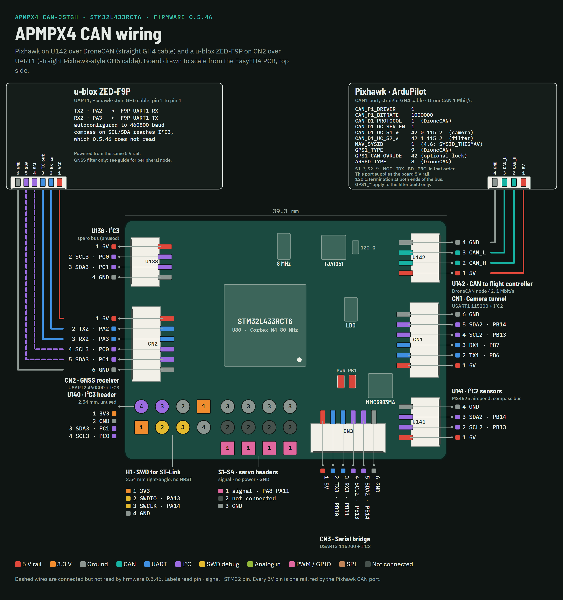

# APMPX4 CAN (STM32L433) Guide

> Board store: [GPS Spoofing Filter](https://airdroper.org/products/gps-spoofing-filter)

The APMPX4 CAN board (EasyEDA project "APMPX4 CAN-JSTGH", schematic V1.0,
2026-03-17) runs either the GNSS filter described in the
[H743 DroneCAN Guide](13_h743_dronecan.md) or the separate CAN peripheral
firmware on a smaller STM32L433RCT6. Both use DroneCAN node `42`.
This guide covers GNSS-filter `0.5.46`, no-GNSS CAN-node bench `0.5.42`
and secured CAN-node `0.5.43`.

Filter `0.5.46` is a bench candidate, not a promoted customer firmware or
flight-qualified image. It has not been tested on physical hardware. The older filter bench evidence below does not
qualify these new reset, CAN and peripheral changes.
It supersedes the withdrawn 0.5.44 and 0.5.45 bench candidates: do not flash
those older images. After upgrading from any older filter, remove all board power for at
least 10 seconds before testing. Recheck compass setup as described in section 5.

**Status, 2026-10-26:** desktop `2026.10.26.1` includes the full offline
Mission Planner plugin **0.6.5** package. Its **Mission Planner plugin 0.6.5**
button opens the folder and instructions; it does not install automatically,
apply presets or flash a board. Download the latest program from the
[official desktop download](https://gps.airdroper.org/download/app), or the
[plugin package](https://gps.airdroper.org/download/mission-planner-mod) separately.
CAN-node `0.5.43` remains the secured customer release. Filter `0.5.46` is
provided only for bench testing; its physical DR1/reset/CAN/PWM checks remain.
The complete L433 handover includes separate flashing paths and checksums.
The EXE uses the reviewed production trust anchor; a manual build without
GitHub attestation is identified as such in its accompanying release evidence.

The live PC check with peripheral-only L433 read all 33 parameters through
the FC tunnel and resumed diagnostics after Mission Planner reconnect. All
104 recorded FC heartbeats were disarmed. This product has no DR telemetry;
`UNKNOWN / STALE` and disabled filter controls are expected. These observations
do not qualify filter `0.5.46`, its DR commands or its fuel readback retries.

**Previous release, 2026-10-23: CAN-node 0.5.43 was released through the desktop app;
0.5.42 remains the GitHub bench prerelease. The L433 GNSS filter remains
unreleased.** Desktop `2026.10.23.1` adds the separate `l433_can_node` target.
Its 0.5.43 image checks the licensed board's UID and RDP1; install it through
the desktop app over ST-Link/SWD. The server catalog now serves promoted 0.5.43;
the official desktop download initially served
app `2026.10.23.1`. That EXE was built manually with the reviewed production
trust anchor and its checksum verified; it has no GitHub build attestation.
The secured 0.5.43 firmware has not been flashed or qualified for flight.
The 0.5.42 direct-SWD download is unchanged,
with firmware date `2026-10-22`; it is not the secured catalog image.
S4 camera movement, all four MCU output-pad readbacks and the camera UART
link have been observed; airspeed worked in earlier bench use. Only S4 had
a connected servo. S1–S3 physical response and failsafe, CAN-loss and reset
tests remain pending. This is bench evidence, not flight qualification.
See the [Changelog](CHANGELOG.md) and section 7.

## 1) Two firmware builds

The separate GNSS-filter `0.5.39` bench image previously passed GPS under a
clear sky and blocked it at a spoofed site with ArduPlane 4.7.1 (see
`docs/dev/evidence/l433-bench-live-spoofing-2026-09-26.md`). Those observations
do not apply GNSS protection to either no-GNSS CAN-node build.

| Build | What it does | Installed by |
|-------|--------------|--------------|
| `apmpx4_can_l433rc_dronecan` | The GNSS spoofing filter: GNSS exclusively on CN2, filtered GPS out as DroneCAN, plus airspeed, compass, camera, fuel and the shared peripheral functions in section 7. | The desktop app (release image), or directly over SWD (bench image) |
| `apmpx4_can_l433rc_dronecan_nognss` / `_nognss_release` | CAN peripheral node: airspeed, onboard compass, S1–S4 servo outputs, CN1/CN2/CN3 serial bridges, buzzer/RGB control, calibrated analog inputs, fuel and node parameters. No GNSS filter or DR0/DR1. | `0.5.42` bench image directly over SWD, or secured `0.5.43` through desktop target `l433_can_node`; hardware validation is partial |

In desktop `2026.10.23.1` or later, select **[!] L433 CAN Node (NO GPS filter)**
and ST-Link/SWD transport. Do not select the L433 GNSS-filter product for a
peripheral-only installation. Activating or updating a secured board can erase
saved settings; back them up and read them back after installation. The app
verifies signed delivery metadata, the connected MCU and licensed UID, the
written app, and RDP1. There is no USB update path or bootloader on this board.
The template `apmpx4_can_l433rc_dronecan_nognss_release` is not a directly
flashable bench binary: use the provisioner to bind it to the board.

Both builds use node ID `42`, so do not put one of each on the same CAN bus.
DroneCAN tools show them as `org.airdroper.gnss_filter.l433_dronecan` and
`org.airdroper.gnss_filter.l433_nognss`, with hardware version `2.0` (the WeAct
H743 is `1.0`). The node information's VCS field holds the full firmware
version: a tool that shows it in hex shows `00000546` for filter 0.5.46 or
`00000542` for CAN node 0.5.42 or `00000543` for secured CAN node 0.5.43.

If two nodes with ID `42` do share a bus, each of them reports
`CAN: another node uses ID 42 - ID clash` every 10 s and reports itself
unhealthy, so the flight controller refuses to arm until one is removed.

### GNSS-filter 0.5.46: resets and CAN reconnects

With healthy backup storage, DR1 intent is saved before the RAM latch changes
or entry messages are sent.
If an operator blocks a node already in automatic DR1, its stricter
`OPERATOR BLOCK` reason is saved before the warning and command ACK. Healthy
retained DR1 restores its reason, trusted anchor/fence and recovery references;
its existing recovery policy remains in force. A CAN reconnect does not clear
DR1 or a retained backup fault. Healthy DR0 restores its trusted takeoff
anchor and a separate recent accepted position/altitude. The first new fix
after the startup guard is checked against those recent references before
publication; it cannot become a fresh unguarded baseline. The one-second
checked backup service captures accepted detector state, including while the
aircraft is far from takeoff, and does not adopt unjudged boot-time fixes.
No receiver-time continuity is assumed across reset. The first absolute
bounds use `SP_ABS_M` (default 2000 m) and `ALT_JMP_M` (default 300 m).
Genuine movement beyond these bounds during an interruption can also block
reacquisition and require recovery; these are conservative bounds, not a
promise that every in-flight reset is transparent.
Warm-reset recovery also retains the DR1 entry altitude and its validity.
Ground recovery cannot silently drop its altitude bound after a reset.
After automatic ground recovery, parked-position monitoring and its trusted
reference survive warm resets; a reset cannot turn that monitoring off.
In 0.5.46 this also bounds height against a genuinely known entry height:
more than 30 m of drift, non-finite altitude or unavailable current altitude
after the startup guard re-trips DR1. Initial UART absence may wait only while
that fixed guard already blocks output. A missing-altitude trip preserves the
known height through DR1 and reset; it cannot recover at an unrelated height.
An originally unavailable height remains optional. Fresh arming ends parked
probation. This does not enable the intentionally disabled absolute barometric
guard or use GNSS-fed FC movement as authority to end probation.
Warm resets also restore ground-release dwell escalation conservatively from
the lifetime release count. A penalty that had decayed during clean DR0 can
therefore return after reset; the lifetime release limit is never refunded.

The backup store uses a primary record, a shadow of trusted references, an
intent/commit marker and a fault word. Writes are checked by reading them back.
An interrupted or damaged record, a blank store after a warm reset, failed
self-test or rejected write causes `DR1 backup fault: GNSS blocked; power cycle`.
This hold blocks GNSS and prevents a new fix from becoming a trusted anchor.
Ordinary recovery, the DR1 maximum-duration setting and operator recovery cannot
clear it.

Clearing a backup-fault hold requires actual power loss that clears the retained
store, followed by a healthy, wholly blank cold boot. Remove **all** board power
for at least 10 seconds; a flight-controller reboot or debugger reset alone is
insufficient. Earlier retained formats, including withdrawn 0.5.44/0.5.45 candidates,
cannot prove the new recent-reference and recovery-field semantics of V3.
Their reason and anchor remain available for diagnosis, but they fail closed
in both DR0 and DR1; upgrading requires one such power cycle. A persistent
backup failure needs repair, rather than repeated recovery commands.

There is a hardware limit: a backup domain that rejects every write, including
the intent and fault words, cannot retain its own failure. Firmware blocks GNSS
in that boot. If hardware later restores old DR0 contents and loses all evidence
of the failure, software cannot distinguish that history from a healthy old
record. Reset and power-fault tests on the actual board remain required.

The filter also discards stale transport state after stalls or reconnects:

- Foreground service aborts a resident GNSS hardware mailbox at 300 ms and
  quarantines a continuous hardware/software transmit backlog at 2 s.
- A queued CAN frame aged 500 ms or more is quarantined at dispatch. Before a
  matching tail is dispatched, an unfinished DroneCAN transfer aged 500 ms
  from its assembly start is quarantined too. This discards queued/partial
  transfers, filter-tunnel bytes and parser state and invalidates FC telemetry;
  fresh evidence is required before GNSS can resume.
- Before each FC-tunnel byte, an incomplete MAVLink message aged 500 ms from
  its first parser start byte is reset, even if the tail arrives in a fresh
  DroneCAN transfer. A fresh start byte can then begin a new message.

Each receive/assembly stage has its own 500 ms budget. This is not a single
500 ms end-to-end latency limit across all stages.

These limits are serviced by the main loop. The autonomous CAN controller can
finish an already authorized DR0 frame while that loop is stalled, before
firmware resumes; the 300 ms limit is not an independent hardware cutoff.
Completed DR1 purging closes GNSS transmission, and software tests do not
replace a physical bus capture. These reset/transport guards need no new parameters. The changes
apply only to the L433 GNSS filter; H743 and CAN-node 0.5.42/0.5.43 are unchanged.

The existing CAN-node peripheral parameters are now also available in this
filter; section 7 describes their scope, controller setup and journal migration.
GNSS blocking does not revoke existing servo authority: an intentional GNSS-only
purge preserves current servo/safety deadlines and the order of control frames
already queued in software. Hardware FIFO and in-progress frames may still be
lost during a CAN reset. Real transport faults, controller changes and hardware
guard trips stop PWM and require fresh safety off and commands.

### Mission Planner plugin 0.6.5 connection checks

Use the updated plugin package with this filter. Status, recovery challenges
and commands use one qualified, open connection. Reconnecting or changing the
FC identity retires cached state and rereads settings. A delayed second link
cannot replace a newer DR1 indication with an older DR0 report.

Changing the primary vehicle clears cached FC position, heading, EFI, fuel
warnings and the full-tank notice. Replacing or reopening its transport also
retires position, heading and EFI. Queued packets from a closed FC link cannot
refresh these readouts. The `FUEL_AUTOF` checkbox stays
indeterminate and disabled until the selected node returns exactly 0 or 1;
unknown does not mean enabled. This resets only the display, not board fuel
consumption or saved parameters. An invalid current FC position also retires
the position and heading cache without discarding EFI.

Plugin 0.6.5 uses the same FC connection for L433; no secondary USB cable is
required. The normal DR stream advances every five seconds. Missing fuel
readbacks get an initial request plus three retries, three seconds apart;
only missing settings are read, and writes/DR commands are not retried.
Startup warnings before live DR qualification are logged as `UNQUALIFIED FILTER`
with their source. They cannot establish DR state, fuel state or command readiness.
DR commands use the captured qualified transport; a replaced connection cannot
redirect them. Fast replies retain their ACK verdict. FC position and EFI
packets also recheck their source context when they commit, so a queued packet
cannot repopulate the previous vehicle's values after a context reset.

The **Position diagnostics** row reports the expected absence of L433 SP/DV
coordinates. RF diagnostics require fresh u-blox MON-RF data; an unsupported
receiver profile can filter normally without these diagnostics. Strict saved
RF-axis capture additionally needs a moving private DR-reference stream, which
L433 does not publish. Servo diagnostic text is recorded in Fuel/Log when sent;
servo, compass and airspeed operation still use the FC's normal DroneCAN pages.
This plugin path is for the GNSS filter, not the separate no-GNSS CAN-node product.

The monitor retains a boot-clock barrier across route changes. If the actual
node has rebooted with a lower uptime while Mission Planner remains open,
right-click the Flight Data map and choose **AirDroper: Reset monitor session**, then wait for
fresh advancing telemetry. This clears only the PC's monitor and does not
send a command, change autopilot settings or release DR1. Do not use it to
accept a delayed link whose node has not rebooted.

Each button press uses a reply token echoed by L433 0.5.46; a matching ACK
proves which command the node answered, not that DR1 remains cleared.
Always check fresh DR status: a persisting spoof indication can re-latch DR1.
Older firmware returns legacy ACKs without this token, so the plugin cannot
confirm an individual press from that ACK. Recovery magic, nonce checks and
unsigned-command policy are unchanged; the token is not authentication.

**L433 map limitation:** filter `0.5.46` publishes neither private `SP_*`
coordinates nor `DV_*` offsets. Its red receiver-position and orange DR-reference
markers are therefore unavailable over the FC/CAN link; no parameter can enable
them. Plugin status, reason, commands, fuel and RF diagnostics remain available.
The plugin must report missing position telemetry rather than invent a location
or imply that a USB cable can provide one on this board. No diagnostic GNSS
stream has been added to L433 in this review.

On the supported H743 streams, the red point is the position **claimed by the
GNSS receiver**, which may be spoofed. It is not the transmitter's location.
Private coordinates and approximate offset reconstruction are labelled
separately. A held offset keeps the FC origin captured with its transaction;
later FC movement alone must not move that red point. Old incident samples
cannot become live in a new DR episode. These plugin changes do not modify
either board's firmware.


## 2) Board and connectors

- STM32L433RCT6 at 80 MHz, clocked from an 8 MHz resonator.
- TJA1051 CAN transceiver at 1 Mbit/s. The 120 Ω termination (R56) is always
  fitted, so the board must sit at one end of the CAN bus: never in the
  middle, and never at the same end as another terminated node.
- JST GH 1.25 mm connectors in Pixhawk pin order. Pin 1 of every connector is
  the same 5 V rail.
- No USB and no display. Programming is over SWD on header H1.
- Status LED `LED1` on `PB1` (see section 8 for what it shows).

| Connector | Use | Pins |
|-----------|-----|------|
| U142 | CAN to the flight controller | 1 `5V`, 2 `CAN_H`, 3 `CAN_L`, 4 `GND` |
| CN2 | GNSS receiver in the filter build; UART bridge in the no-GNSS node, USART2 | 1 `5V`, 2 `TX2` (`PA2`), 3 `RX2` (`PA3`), 4 `SCL3`, 5 `SDA3`, 6 `GND` |
| CN1 | Camera MAVLink tunnel, USART1 at 115200 | 1 `5V`, 2 `TX1` (`PB6`), 3 `RX1` (`PB7`), 4 `SCL2`, 5 `SDA2`, 6 `GND` |
| U141 | I2C2 sensors: MS4525 airspeed | 1 `5V`, 2 `SCL2` (`PB13`), 3 `SDA2` (`PB14`), 4 `GND` |
| CN3 | USART3 bridge in both builds; shared I2C2 | 1 `5V`, 2 `TX3`, 3 `RX3`, 4 `SCL2`, 5 `SDA2`, 6 `GND` |
| H1 | SWD for ST-Link, 2.54 mm; no NRST | 1 `3V3`, 2 `SWDIO` (`PA13`), 3 `SWCLK` (`PA14`), 4 `GND` |

U138 and U140 carry the spare I2C3 bus. S1–S4 are servo headers (signal,
not connected, GND) with no power on them. Both builds provide the servos
and buzzer/RGB control described in section 7. The compass on CN2 pins 4–5
(I2C3) is not read. The onboard
MMC5983MA compass sits on I2C2 at `0x30`.

The drawings show the filter-mode wiring; section 7 describes the shared
peripheral functions. The complete pinout, with both board sides, every solder pad and the pin tables,
is an A3 drawing:
[l433_apmpx4_can_pinout.pdf](https://github.com/AirdroperUA/gnss-filter-user-docs/blob/main/diagrams/l433_apmpx4_can_pinout.pdf)
(Ukrainian:
[l433_apmpx4_can_pinout_uk.pdf](https://github.com/AirdroperUA/gnss-filter-user-docs/blob/main/diagrams/l433_apmpx4_can_pinout_uk.pdf)).

## 3) Wiring and power



1. **Flight controller:** a straight Pixhawk CAN cable from U142 to the FC's
   CAN1 port, pin 1 to pin 1. This cable also powers the board: feed the 5 V
   rail from exactly one source, normally the FC's CAN port.
2. **GNSS receiver (filter build):** a straight Pixhawk GPS cable from CN2 to
   the receiver's UART. Board `TX2` lands on the receiver's RX and `RX2` on its
   TX. The receiver type is the node's `GNSS_TYPE` parameter: `0` u-blox (the
   default, autoconfigured to 460800 baud), `1` UM980/UM981, `2` Septentrio
   Mosaic. For a UM980 or Mosaic, set `GNSS_TYPE` (section 5 says how to reach
   the node's parameters), wait for the node's `Tune saved` message (a few
   seconds, or up to about a minute after an earlier save), and then remove
   the board's power for a few seconds; only after that power-up is the
   receiver found by a baud scan. The board has no reset button, and Mission
   Planner's DroneCAN restart does nothing on this node. A UM980 also needs its
   one-time setup from the [GNSS Receiver Configuration](09_receiver_config.md)
   guide, and a Mosaic the SBF setup in the H743 guide's
   [Septentrio Mosaic X5 SBF input](13_h743_dronecan.md#septentrio-mosaic-x5-sbf-input)
   section.
3. **Camera:** CN1 to the camera's UART, crossing TX and RX by function. Power
   the camera from its own supply unless its draw fits the FC CAN port budget,
   and leave CN1 pins 4–5 free: they are the sensor bus.
4. **Airspeed:** a Pixhawk-style MS4525DO airspeed module on U141, straight
   cable. Pin 1 of U141 is the 5 V rail, and the sensor bus is pulled up to
   3.3 V on the board and shared with the onboard compass, so use a module that
   takes 5 V in, regulates its own 3.3 V and keeps its I2C lines at 3.3 V. Do
   not wire a bare 3.3 V sensor to U141. The sensor on the module must be the
   one the H743 guide specifies (`4525DO-DS3AI001DP`: address `0x28`,
   `-1..+1 psi`, transfer function A).

**3.3 V logic only.** CN2 takes 3.3 V logic only: the board's receive pin
there (`RX2`, `PA3`) is not 5 V tolerant, and the STM32L433 datasheet rates it
3.6 V tolerant. Connect a receiver's 3.3 V UART (the u-blox, UM980 and Mosaic
receivers this guide covers have one), never 5 V TTL or RS-232 levels. The
servo headers S1–S4 and CN1's receive pin (`RX1`, `PB7`) are 3.3 V-only too,
the way the firmware sets them up: the internal pull resistors it enables
remove the chip's 5 V tolerance.

**Onboard compass.** The MMC5983MA sits a few millimetres from the status LED
and from the 5 V tracks that feed CN1 (the camera). If you use the onboard
compass, power the camera separately where possible, and check the compass
heading with the camera on and off.

The ST-Link's 3.3 V is not enough for CAN. The TJA1051 runs from the 5 V rail,
so on ST-Link power alone the MCU runs but CAN goes bus-off.

## 4) Flashing

Flashing with the desktop app (activation, update or recovery) erases the
board's saved parameters. `GNSS_TYPE` returns to `0` (u-blox), so a board with
a UM980 or Mosaic then finds no receiver until `GNSS_TYPE` is set again
(section 3, step 2). Set it, `FUEL_CAPG` and any other changed parameter again
afterwards. A bench upload with PlatformIO over SWD
(`pio run -e ... -t upload`) erases only the flash pages the image covers, so
the saved parameters survive it. The new filter journal is not readable by the
released no-GNSS node: export, restore and verify the destination configuration
when changing between builds (section 7).

**With the desktop app (release image).** In the AirDroper desktop app choose
**[!] L433 CAN Node (NO GPS filter)** for peripheral firmware, or the
**L433 APMPX4 CAN (ST-Link)** for GPS protection. The app downloads the image bound to this board's
unique ID, checks its signature, writes it over ST-Link, reads it back, and then
locks the chip (RDP1). The board has no reset button: when the app asks you to
power-cycle the board, and again when it finishes, remove all power for at
least 10 seconds and then power it again. It needs a published L433 release, so
the GNSS-filter installation path does not work yet (see Status above).
The secured CAN node uses target `l433_can_node` and version `0.5.43`;
the GitHub CAN-node 0.5.42 bench image is installed directly over SWD instead.

After an L433 **GNSS-filter** flash the app also prints the board's
`Authenticated DR-recovery signing key` and tells you to save it now: there is
one key per board, and it cannot be recovered later. Keep it secret, like a
password: anyone who has it can authorize a DR1 recovery on that board.
The no-GNSS CAN node has no DR recovery key or DR1 recovery function.

A release image refuses to start on a board it is not bound to, and on a board
that is not locked. It then blinks the LED fast, 100 ms on and 100 ms off. Run
the update again in the desktop app.

**Directly over SWD (bench images).** Wire H1 to the ST-Link: `SWDIO`, `SWCLK`
and `GND`. On a genuine ST-LINK/V2, V3 or Nucleo probe, pin 1 (`3V3`) is the
target-voltage sense and must be connected, and the board must be powered from
elsewhere; on a clone probe that pin supplies 3.3 V, so connect it only when
nothing else powers the board. H1 has no NRST, so connect in Normal or Hot-plug
mode, never under reset. Then build and upload:

```text
pio run -e apmpx4_can_l433rc_dronecan -t upload
pio run -e apmpx4_can_l433rc_dronecan_nognss -t upload
```

A board the desktop app has locked (RDP1) cannot be programmed this way. Unlock
it first. The desktop app's **Recover Board** does that for an L433: it removes
the lock, which erases the whole chip, and checks that the flash is blank. From
the command line, use STM32CubeProgrammer and set only the RDP option byte,
then remove all power for at least 10 seconds:

```text
STM32_Programmer_CLI -c port=SWD mode=NORMAL -ob RDP=0xAA
```

Unlocking erases the whole chip: the firmware and its parameters. The
power-off after it clears the fuel record and any DR1 state the board kept
across resets (section 8). Never write `RDP=0xCC`: that is level 2, which
disables SWD for good.

Never flash `apmpx4_can_l433rc_dronecan_release` or
`apmpx4_can_l433rc_dronecan_nognss_release` directly: they only run after
the server has bound them to a board and the desktop app has locked the chip.

After the first flash of a blank chip, power-cycle the board. A blank STM32L4
keeps starting its ROM bootloader until a power-on reset.

## 5) Flight controller setup (ArduPilot)

ArduPilot 4.6.1 or newer is required: the filter build keeps GPS off an older
autopilot.

The CAN and tunnel settings are the same as on the H743. The H743 guide's
section 6 applies unchanged, including its hard preconditions for GPS output:
the filter tunnel carrying a live `EKF_STATUS_REPORT`, and the flight
controller's MAVLink system ID set to 1: `MAV_SYSID = 1` on ArduPilot 4.7 and
newer, `SYSID_THISMAV = 1` on 4.6. The filter accepts flight controller
telemetry only from system 1, component 1.

| Purpose | Parameter | Value |
|---------|-----------|-------|
| CAN driver on CAN1 | `CAN_P1_DRIVER` | `1` |
| DroneCAN protocol | `CAN_D1_PROTOCOL` | `1` |
| CAN bitrate | `CAN_P1_BITRATE` | `1000000` |
| GPS type (filter build) | `GPS1_TYPE` | `9` (DroneCAN) |
| GPS auto-config (filter build) | `GPS_AUTO_CONFIG` | `1` |
| Optional GPS node lock (filter build only, see section 7) | `GPS1_CAN_OVRIDE` | `42` |
| Enable DroneCAN serial | `CAN_D1_UC_SER_EN` | `1` |
| Camera port node / index / baud / protocol | `CAN_D1_UC_S1_NOD` / `_IDX` / `_BD` / `_PRO` | `42` / `0` / `115` / `2` |
| Filter port node / index / baud / protocol | `CAN_D1_UC_S2_NOD` / `_IDX` / `_BD` / `_PRO` | `42` / `1` / `115` / `2` |
| FC MAVLink system ID (4.6: `SYSID_THISMAV`) | `MAV_SYSID` | `1` |
| Airspeed | `ARSPD_TYPE` | `8` (DroneCAN) |

- **Airspeed:** calibrate the pitot in the installed airframe, then set
  `ARSPD_USE = 1` and `AHRS_OPTIONS` bit 0. With the filter build this is a
  flight-safety requirement: the aircraft has to fly GPS-denied the moment DR1
  latches (see the H743 guide).
- **Compass:** in Mission Planner open `Setup -> Mandatory Hardware -> Compass`,
  confirm a compass from node `42` appears, set its orientation and priority,
  and calibrate it in the installed vehicle. The onboard MMC5983MA is compass
  `0` of node `42`. In filter `0.5.46`, external HMC5x83 uses sensor ID `1`
  and external QMC5883L uses sensor ID `2`; these IDs follow the family,
  independent of probe order. An upgrade with a QMC therefore creates a new
  compass identity: check its priority/orientation and recalibrate it before use.
  Released no-GNSS 0.5.42/0.5.43 still use external ID `1` for either family.
  Replacing a compass with another of the same family does not change its ID;
  always recheck orientation and recalibrate after any physical replacement.
- **Tunnel ports:** `_PRO` must be `2` (MAVLink2) on both ports; with `1`, the
  node discards that port's traffic. Reboot the flight controller after
  changing any CAN or `CAN_D1_UC_*` serial setting: ArduPilot sets up the CAN
  driver and the tunnel ports only when it boots.
- **The node's own parameters** (`GNSS_TYPE`, `FUEL_CAPG` and the rest) are
  reached through the flight controller, since the board has no USB: in Mission
  Planner open `SETUP -> Optional Hardware -> DroneCAN/UAVCAN`, connect, and
  open **Menu -> Parameters** on node `42`. The H743 guide's section 7,
  Option A, has the full procedure. Where it says to reboot the board, that
  means a power cycle here: wait until the node has saved the value (it reports
  `Tune saved`), then remove the board's power for a few seconds, and check
  afterwards that the value survived. The board has no reset button, and the
  node does not implement DroneCAN's RestartNode, so Mission Planner's DroneCAN
  restart does nothing.
- **Swapping boards:** the flight controller remembers which board holds node
  `42`. After replacing it with another board (an L433 for an H743, or one L433
  for another), it reports `Duplicate Node` and refuses to arm. Set bit 0 of
  `CAN_D1_UC_OPTION` without changing its other bits (if the value is even,
  add 1 to it), then reboot the flight controller once: at boot ArduPilot
  clears its node database and then the bit. Calibrate the compass again as
  well: to the flight controller the new board's compass is the old one, and
  it would keep the old board's calibration.

### ArduPlane 4.7.1: EKF3 during DR1

**Required manual step: preserve `AHRS_OPTIONS` and set bit 0.** Read its
current integer value and write `old | 1`: `0 → 1`, `16 → 17`, `17 → 17`.
Read it back. Do not replace an unknown bitmask with `1`. For QuadPlane,
review VTOL operation separately; `old | 3` also sets its bit 1.

This inhibits the later fixed-wing DCM fallback choices while EKF3 still
provides valid attitude and vertical estimates. It is **not an absolute
never-DCM guarantee**: `_active_EKF_type()` can select DCM earlier during
startup or when those EKF estimates are unavailable.
See the [official Plane-4.7.1 AHRS implementation](https://github.com/ArduPilot/ardupilot/blob/Plane-4.7.1/libraries/AP_AHRS/AP_AHRS.cpp#L1896-L2058).

The new companion file
`presets/arduplane_FC_4.7.1_l433_filter_EKF3_after_calibration.param` in the
Mission Planner package supplies these settings:

| FC parameter | Value / purpose |
|--------------|-----------------|
| `AHRS_EKF_TYPE` / `EK3_ENABLE` | `3` / `1`: EKF3 |
| `EK3_SRC1_POSXY` / `EK3_SRC1_VELXY` | `3` / `3`: filtered GPS when available |
| `EK3_SRC1_POSZ` / `EK3_SRC1_VELZ` | `1` / `0`: barometric height; no GPS vertical-velocity source |
| `EK3_SRC1_YAW` | `1`: calibrated compass |
| `ARSPD_TYPE` / `ARSPD_USE` | `8` / `1`: calibrated DroneCAN pitot used for control |

The source values follow the [official EKF source definitions](https://github.com/ArduPilot/ardupilot/blob/Plane-4.7.1/libraries/AP_NavEKF/AP_NavEKF_Source.cpp).
`ARSPD_USE = 1` enables control use: load this file **only after** the fitted
pitot is healthy and calibrated, as described by the
[official airspeed parameters](https://github.com/ArduPilot/ardupilot/blob/Plane-4.7.1/libraries/AP_Airspeed/AP_Airspeed_Params.cpp).

1. Back up every FC parameter. Keep the FC disarmed with ignition and servo
   linkages disconnected for the bench change. Complete the transport setup
   above and check that the FC's only enabled GNSS path is the L433 filter.
2. Verify the installed compass orientation/calibration, healthy barometer
   and calibrated pitot. The file preserves their individual calibration,
   servo functions and aircraft failsafes.
3. Confirm source set 1 is active. Review RC/script source switching, alternate
   sets and `EK3_SRC_OPTIONS` bits 0/3 (all-velocity fusion/per-core sources);
   they must not introduce GPS-dependent vertical or yaw aiding behind this
   profile. Resolve a custom source configuration before loading the file.
4. Load the companion file, write the nine values, then perform the required
   `AHRS_OPTIONS = old | 1` step above. The file deliberately contains no
   static `AHRS_OPTIONS` assignment and is incomplete without this step.
5. Read all changed parameters back, reboot the FC while disarmed, and read
   them back again. Verify the actual EKF3 state and sensor health; a saved
   `AHRS_EKF_TYPE = 3` alone does not prove EKF3 is the active estimator.
6. Complete controlled GPS-loss/recovery bench and SITL checks before flight.
   EKF3 dead reckoning drifts and does not maintain a reliable global position
   indefinitely. This preset does not configure an aircraft-specific failsafe
   response or qualify a flight through GNSS loss.

## 6) Optional sensors

The MS4525 airspeed sensor and the compass are both compiled into both builds,
and both are optional:

- A sensor that does not answer after power-up counts as not fitted. It raises
  no fault and no `I2C AIR=... MAG=...` warning, so the node stays healthy.
- A sensor that answered and then stops answering raises the fault: ArduPilot
  reports `Node 42 unhealthy!` and refuses to arm, as on the H743.
- A sensor that first answers later than power-up counts as fitted from then on.
  ArduPilot, however, looks for airspeed sensors only when it boots, so reboot
  the flight controller after plugging one in.
- The first compass found after power-up is the only one used until power-off.
  If it stops answering, the node reports the fault; it never switches to
  another compass, such as the onboard MMC5983MA, whose calibration and
  orientation would differ.

The node publishes airspeed as `RawAirData` and the compass as
`MagneticFieldStrength2`, raw. All calibration belongs to ArduPilot.

**Flying the filter build without a pitot** costs DR1 recovery: the
ground-speed-versus-airspeed check can never pass, so leaving DR1 in flight
needs a real climb or a steady turn; straight-and-level flight will not do it.

## 7) The no-GNSS CAN node

### Shared peripheral functions in the new filter

GNSS-filter `0.5.46` includes the same servo, diagnostics, CN3 serial, buzzer/RGB
and calibrated analog functions described below. Its GNSS protection stays
active: CN2 is dedicated to the receiver, `N_U2_BAUD` is read-only `0`, and
raw bridge port `2` is unavailable. Set the receiver through `GNSS_TYPE` and
`UBX_BAUD`; use CN3 for an additional serial device. The filter now uses
`N_FC_ID`, default `10`, for FC tunnel/status and servo authority instead of
automatically binding a controller. H743 and released CAN-node `0.5.42`/
`0.5.43` are unchanged. This filter has not been flashed or flight-qualified.

The filter appends all 23 `N_*` keys without changing stored key IDs. It saves
95 keys and exposes 96 parameters including `UBX_RESET`, retaining all GNSS
tuning. Its L433-filter-only 1024-byte BTN4/schema-4 journal migrates legacy
512-byte records and keeps the newest legacy snapshot until a new commit
succeeds. Schema-3 profile choices remain intact. Released no-GNSS firmware
cannot read BTN4 and may find an older legacy snapshot instead. **Back up
settings before switching builds, then restore and read back the complete
configuration for the destination firmware.** The base node's smaller saved
subset described below is unchanged.

### Separate no-GNSS firmware and its bench evidence

`apmpx4_can_l433rc_dronecan_nognss` is a CAN peripheral node for aircraft
that use a separate GPS: MS4525 airspeed, the onboard MMC5983MA compass, four
servo outputs, serial bridges, buzzer/RGB control and calibrated analog inputs.
Version `0.5.42` is a GitHub bench prerelease for direct SWD installation at
`0x08000000`, with no server target. It is the same 105,596-byte bench image,
not a new binary under the old version.
Secured `0.5.43` uses the same node feature set with UID/RDP1 enforcement and
its own `l433-node-release` identity. It is delivered by desktop target
`l433_can_node`; it is a different artifact and has not inherited exact-artifact
hardware qualification from 0.5.42.

**Hardware validation is partial.** After the external servo BEC was connected,
S4 moved the camera for a commanded change from 1800 to 1200 µs and returned
close to the starting view at 1800 µs. Only S4 had a connected servo; physical
response on S1–S3 remains unverified. Live GPIO readbacks of PA8–PA11 showed
HIGH and LOW with TIM1 AF1 push-pull routing, but do not measure connector
voltage or pulse timing. The camera UART/CAN link worked, and airspeed had
worked in earlier bench use. Physical command-loss/stalled-loop cutoff, CAN
disconnect/reconnect and reset HIL are still required before flight; other
fitted functions are not certified by the S4 test. S1–S4 headers do not supply
servo power: connect the external servo supply and common ground before testing.

The no-GNSS build publishes no `Fix2` or `Auxiliary`, has no spoofing detector or
DR0/DR1 state, and supplies no GNSS protection. Leave `GPS1_TYPE` configured
for the aircraft's real GPS. When switching from the filter build, set
`GPS1_CAN_OVRIDE` back to `0` or to that GPS node's actual ID; a lock on `42`
would prevent the real GPS from being used.

The node exposes and saves only its 23 `N_*` settings, the 9 fuel settings and
`LOG_MS`. Filter-only GNSS/DR1 parameters and `UBX_RESET` are hidden. An old
filter journal can supply matching fuel/log settings, but the next node save
omits the inactive filter settings. **Before switching back to the filter
firmware, restore and verify its GNSS and protection tuning.** The node's
messages come once from system 42; it does not impersonate the FC's GPS
component and has no DR-recovery signing key.

### Controller and servo setup

Control comes only from the CAN node selected by `N_FC_ID` (default `10`).
`42` is this peripheral node itself and is not allowed as `N_FC_ID`.
Match the FC's `CAN_D1_UC_NODE` to it; this is distinct from its MAVLink system
ID. Servo commands, safety and DISARMED evidence come from this selected
CAN source. Direct DroneCAN parameter requests may come from a GCS node;
writes still require fresh DISARMED from the selected FC. The administrative
MAVLink tunnels accept only that selected FC. Servo control and direct
DroneCAN parameter access work without a filter MAVLink tunnel. Keep that
tunnel from section 5 for status text and fuel telemetry; those FC MAVLink
fields still require `MAV_SYSID = 1` (`SYSID_THISMAV = 1` on ArduPilot 4.6).

| FC setting | Value for the default node setup |
|------------|----------------------------------|
| `CAN_P1_DRIVER` / `CAN_D1_PROTOCOL` | `1` / `1` |
| `CAN_P1_BITRATE` | `1000000` |
| `CAN_D1_UC_NODE` | `10`, matching node `N_FC_ID` |
| `CAN_D1_UC_SRV_BM` | `15` to send SERVO1–SERVO4 |
| `CAN_D1_UC_SRV_RT` | `50` |
| `CAN_D1_UC_OPTION` | Preserve existing bits; bit `4` (value `16`) optionally sends PWM microseconds |
| `ARSPD_TYPE` | `8` for MS4525 airspeed |

For initial setup, use controller ID `10`. To change it, first confirm the
current selected FC is DISARMED and write the new `N_FC_ID` to the node.
Then set the FC's `CAN_D1_UC_NODE` to that new ID and reboot the FC. The source
change clears old arming evidence and queued traffic, so wait for fresh
DISARMED from the new ID and `Tune saved` before power-cycling the node and
reading `N_FC_ID` back. Factory reset returns `N_FC_ID` to `10`; configure
the FC to match before expecting control again.

Assign the desired `SERVOx_FUNCTION` on the FC. The node accepts standard
DroneCAN `actuator.ArrayCommand` with UNITLESS (`0`) or PWM (`4`) commands;
with the defaults, unitless `-1`, `0`, `+1` becomes `1000`, `1500`, `2000` us.
The FC's safety state must be freshly **off** before pulses can start; merely
arming a vehicle or sending a command is insufficient.

Connect S1–S4 signal pins (`PA8`–`PA11`) and GND. The middle pin of each
header is **not connected**: supply servos from a separate suitable supply and
share its ground with the board. Signals are 3.3 V; do not feed servo power
into a signal pin. All four outputs share `N_SRV_HZ`, initially `50` Hz.

Each channel independently times out after `N_SRV_TMO`, initially `500` ms.
Commands for another channel cannot keep it alive. At boot and whenever safety
is on, unknown or older than `1500` ms, or controller communication is lost,
pulses stop. With fresh safety off, command timeout instead selects that
channel's `N_Sx_FS`: `0` stops pulses (the default); a nonzero pulse is bounded
by `N_SRV_MIN` and `N_SRV_MAX`. Set nonzero failsafes only after checking the
installed mechanism's safe position. A new valid command is needed to resume.

A real CAN fault, controller rebind or node-ID conflict discards control
authority before further receive processing. While the link is unavailable, safety-off and
actuator commands are ignored. Returning online requires fresh safety off and
new commands. Counter rollover after about 49 days cannot revive expired
commands or an expired safety-off state.

An intentional GNSS-only purge in the filter preserves current servo/safety
deadlines and the order of control frames already in the software RX queue.
Hardware FIFO and in-progress frames can still be lost during a CAN reset.
The GNSS output gate remains independent of servo authority.

An independent timer checks command and safety expiry every `1` ms, including
when the main loop stalls. Pulse-width changes take effect at the next PWM
frame. A separate hardware guard forces all four signal pins LOW if that
timer stops being serviced for `3` ms, including when interrupts are disabled.
After a guard trip, fresh safety off and new commands are required; cached
commands cannot restart the outputs. A single-bank flash save may stall
interrupt service long enough to trip this guard.

CAN safety and command age is measured at reception, not when the main loop
eventually processes a queued frame. Multi-frame commands retain the first
fragment's age. A delayed command has only its remaining timeout available;
expired buffered traffic cannot renew PWM after a main-loop stall.

For RPM-based fuel telemetry, keep the Hall pickup as the FC's direct RPM1
source. A missing RPM stream or a sample over `2000` ms old is reported in EFI
as a crankshaft-sensor fault, with numeric RPM `0`; conservative fuel accounting
continues. Do not feed EFI-derived RPM back into this estimator.
Fresh zero RPM also remains a fault for fuel estimation while the last
observed throttle is open, even if throttle telemetry has expired; the
conservative degraded estimate continues until usable evidence changes.
`FUEL_AUTOF` remains `0` by default. When enabled, automatic full-tank
establishment is available only on an eligible cold power-on with no retained
fuel record and a working backup store, after the stopped-engine checks pass.
Engine activity, a capacity/density edit or factory-reset preparation cancels
that permission. A warm reset or later loss of accounting does not refill the
tank automatically; use the normal stopped-engine `FUEL_CAPG` procedure.

### Servo diagnostics in Mission Planner

CAN-node `0.5.42`/`0.5.43` and filter `0.5.46` automatically send one `SV*`
INFO row per second through the node's MAVLink tunnel. Open
**Flight Data → Messages** and allow at least 12 s
for a full cycle; parameter downloads/writes temporarily pause these rows.
Each row is a new observational snapshot, so different rows have different
sample times. Diagnostics do not release safety, renew commands, reset the
guard or alter PWM. No diagnostic setting needs saving.

| Row | Meaning |
|-----|---------|
| `SVRX f… a… s…` | Raw actuator frames from any source; completed actuator arrays and safety transfers from the selected FC |
| `SVSRC a… s… st… i… t… u…` | Last raw actuator/safety source IDs; last decoded selected-FC safety status (`255` off, `0` on, `-1` none); last decoded actuator ID/type (`-1` none); ignored entries for unmapped IDs |
| `SV1`–`SV4 i… n… a… p…/… LABEL` | Output's mapped actuator ID; accepted-command count; current command age in ms; desired/software-applied us; current state |
| `SVHW C… M… E… G… R…` | TIM1 running; main output enable; channel-enable register in hex; latched guard fault; pending transport reset |
| `SVTIM p… a… t2… t7…` | TIM1 prescaler and auto-reload registers; TIM2/TIM7 running flags |
| `SVCCR …/…/…/…` | TIM1 compare registers in timer ticks, not microseconds |
| `SVREJ n… REASON a…` | Rejected-event count; most recent historical rejection and its age in ms |
| `SVG n… d… e… left…` | Guard-trip count; raw DMA flags in hex; guard DMA enabled; remaining DMA transfers |
| `SVSAFE f… a… on… off…` | Raw safety-frame count; last selected-FC safety-transfer age; accepted safety-on/off event ages |

Counters start again at node reset and wrap after `4294967295`; none is stored
in flash. An age of `-1` means absent; displayed ages saturate at `99999` ms.
A historical rejection can remain visible while new commands work. A raw
frame is not proof that its source, payload or CRC was accepted. A completed
array need not contain an ID mapped to S1–S4; watch each output's `n` counter.
Valid entries for other outputs increase `u`, not the rejection count.

State labels: `START` not initialized; `LINK` CAN unavailable; `GUARD` cutoff
or guard fault; `RESET` transport purge pending; `CONFIG` invalid configuration;
`SAFETY` no fresh safety-off; `IDOFF` output disabled; `NOCMD` no accepted
command; `TIMEOUT` expired command with no pulses; `ZERO` explicit zero pulse.
`FAILSAFE` means an expired command selected a configured nonzero failsafe.
`TIMER`, `MOE` and `CCOFF` identify a stopped timer, cleared main output enable
or disabled channel while policy requests a pulse. `PWM` means the software
policy and reported timer enables permit PWM. Rejection labels are `SOURCE`,
`PAYLOAD`, `TIMING`, `AUTH` and `COMMAND` (a mapped command with an unsupported
type, non-finite value or value outside its admissible range); `NONE` means
none recorded.

For the temporary Mission Planner button setup, retain FC
`SERVO5`–`SERVO8_FUNCTION=0`, include channels 5–8 in `CAN_D1_UC_SRV_BM`, and
map node `N_S1_ID`–`N_S4_ID` to `5`–`8`. With safety released and the FC
disarmed, button presses should increase the corresponding `n` counter and
change `p`. Hold one target for at least 15 s to correlate the rows.
At 50 Hz and an 80 MHz timer clock, `SVTIM p24 a63999` gives
`pulse_us = CCR × 25 / 80`; 1500 us is CCR `4800`. A 1 MHz guard clock has
TIM2 prescaler `79`; TIM7 should be running.

**These rows do not measure a connector waveform, servo supply or movement.**
The software-applied cache can stay nonzero after a hardware break; check
`M`, the DMA flags and the compare registers. DMA remains live during a
snapshot, and compare preloads may await the next PWM period. Verify actual
50 Hz pulses with a scope/logic analyzer against the node's GND.

### Node parameters

Read/write them through node `42` in Mission Planner's DroneCAN parameter
inspector. Writes require fresh DISARMED from the selected controller. Wait
for `Tune saved`, then power-cycle and read back the settings. The complete
per-parameter limits are in the [tuning manual](06_tuning.md).

| Node setting | Default | Purpose |
|--------------|---------|---------|
| `N_FC_ID` | `10` | Selected FC tunnel/status and servo controller CAN node ID |
| `N_SRV_HZ` / `N_SRV_TMO` | `50` / `500` | Common PWM Hz / per-channel timeout ms |
| `N_SRV_MIN` / `N_SRV_MAX` | `1000` / `2000` | Pulse endpoints in us |
| `N_S1_ID` / `N_S2_ID` / `N_S3_ID` / `N_S4_ID` | `1` / `2` / `3` / `4` | Actuator IDs routed to S1–S4; `0` disables an output |
| `N_S1_FS` / `N_S2_FS` / `N_S3_FS` / `N_S4_FS` | `0` / `0` / `0` / `0` | Command-timeout failsafe pulse, us; `0` stops pulses |
| `N_V1_MULT` / `N_V2_MULT` | `0` / `0` | Voltage divider calibration; `0` disables publication |
| `N_I1_GAIN` / `N_I2_GAIN` | `0` / `0` | External current-sensor gain, A/V; `0` means unknown current |
| `N_I1_OFF` / `N_I2_OFF` | `0` / `0` | Zero-current ADC voltage, V |
| `N_ADC_VREF` | `3.3` | Measured ADC reference voltage, V |
| `N_U2_BAUD` / `N_U3_BAUD` | `115200` / `115200` on the base node | CN2/CN3 bridge baud; `0` disables a bridge. The filter locks `N_U2_BAUD` at `0` for receiver-only CN2 |
| `N_LED_ID` | `0` | External RGB light ID accepted in `LightsCommand` |

All nonzero `N_Sx_ID` values must be distinct, and `N_SRV_MIN` must be
less than `N_SRV_MAX`. Invalid combinations inhibit all servo outputs.

### Serial, analog and indication connections

The remote serial IDs are `0` for CN1 camera, `1` for the node's own MAVLink
parameter/status link, `2` for CN2 USART2 (`PA2` TX / `PA3` RX) on the no-GNSS
node only, and `3` for
CN3 USART3 (`PB10` TX / `PB11` RX). Match the attached UART to its node baud
setting; CN1 remains `115200`. In the filter, CN2 is receiver-only and
`N_U2_BAUD` reads `0` and rejects writes. For enabled bridge ports, positive
values `1`–`2399` are normalized to `2400`; `0` disables the port.
CN2 requires 3.3 V UART logic, even though its
power pin supplies 5 V.

Bridge ports collect partial chunks for up to `5` ms and alternate service when CAN
is busy. UART baud is not a guarantee of simultaneous sustained throughput:
all tunnels, servo commands and sensors share the `1` Mbit/s CAN bus. Check
the combined traffic under load; an overloaded bus can still lose serial data.
If a progressing TX queue stays busy for two seconds, queued transmissions
are discarded to bound delay. This serial congestion cleanup preserves servo
authority. A real CAN outage still revokes authority and requires fresh safety
off and commands after recovery.

For example, on the no-GNSS node, to use CN2 instead of the camera on an available FC virtual port,
set `CAN_D1_UC_SER_EN=1`, `CAN_D1_UC_S1_NOD=42`, `CAN_D1_UC_S1_IDX=2`,
`CAN_D1_UC_S1_BD=115` and `CAN_D1_UC_S1_PRO=2`; keep S2 mapped to index `1`
for the node's messages. Select remote index `3` instead for CN3 in either
build; the filter rejects raw CN2 bridge traffic. Reboot the
FC after changing these settings. ArduPilot firmware commonly exposes only
S1/S2/S3 virtual ports per CAN driver: choose which remote ports to map rather
than expecting an S4 group. Bytes in CN2/CN3 are carried unchanged; the node
does not infer or parse their attached device's protocol. This build requires
the `Targetted` MAVLink2 transport tag (`1`), as for the camera; that is not
a claim that arbitrary ArduPilot serial drivers use a compatible transport.

BAT1/PC2 and BAT2/PC4 measure voltage through dividers. The board documents
conflicting resistor values: the actual factor may be `11` or `21`.
**Leave both `N_Vx_MULT` values at `0` until you check the fitted parts and
calibrate against a meter.** CUR1/PC3 and CUR2/PC5 accept an external current
sensor's 0–3.3 V output; there is no current sensor fitted on the board.
Set its gain/offset from measurements, using
`current_A = (ADC_V - N_Ix_OFF) * N_Ix_GAIN` and a measured `N_ADC_VREF`.
Enabled circuits publish `uavcan.equipment.power.CircuitStatus` (`1091`),
with circuit IDs `1` and `2`; an uncalibrated current is NaN. These are raw
electrical readings, not `BatteryInfo`: selecting `BATT_MONITOR=8` does not
turn them into an FC battery gauge or battery failsafe. They do not change
the separate RPM-based fuel estimate.

The external buzzer pads BZ+/BZ− are switched by PA0 through an S8050 NPN.
The node accepts `BeepCommand` (`1080`), with tones from `1` to `10000` Hz
and duration limited to `30` s. Use a suitable piezo buzzer, or fit a flyback
diode for a magnetic one; this board has no flyback diode. PA1/U122 supplies
the data signal for an external addressable RGB LED, selected by `N_LED_ID`
from `LightsCommand` (`1081`). No buzzer or RGB strip is fitted on these pads.
Match the external device's power and data requirements; the board provides
a 3.3 V data signal, not an LED power driver. The normal PB1 status LED stays
as described below. Spare I2C3 and SPI pads are still exposed for external
hardware; this build does not add drivers for arbitrary devices on them.

RGB transmission targets WS2815B-V1 timing and uses DMA, leaving UART interrupts
enabled at higher configured bridge baud rates. Verify the waveform and colors
with the particular external strip on the bench; WS2815 revisions differ.

Before using these additions, bench-check all servo directions/endpoints,
power-up, safety-on, individual command timeout, CAN disconnect/reconnect,
reset, a stalled main loop and disabled-interrupt cutoff with the mechanical
loads disconnected. Check every UART both ways,
compare analog readings with instruments, and verify compass behavior with
servo/camera loads on and off. The earlier GNSS bench evidence does not
validate any of these new outputs.

## 8) Troubleshooting

The board has no display. Its status messages reach Mission Planner through the
filter tunnel (DroneCAN serial port 2 on the flight controller, index `1`), so
without that tunnel there are no messages at all. The lines from the first
seconds after power-up, before the tunnel connects, are held and sent as soon
as it does: the start-up banner, the firmware version and board ID, and, with
room of their own, the warnings, such as the reset and DR1 lines below. The LED
shows the state:

| LED1 | Meaning |
|------|---------|
| 80 ms flash every 6 s | Running, DR0 (GNSS output allowed if every other check passes); the no-GNSS build always shows this |
| 50 ms flash every 250 ms | DR1: GNSS blocked |
| 100 ms on, 100 ms off, right after power-up | The firmware refused to start: the release image is bound to another board, or the board is not locked. Run the update again in the desktop app |

- **Node 42 does not appear:** check that U142 has 5 V, that the cable is
  straight (pin 1 to pin 1), the bitrate is `1000000`, and that the board sits
  at an end of the bus.
- **CAN bus-off on the bench:** the board is probably on ST-Link power only.
  Give the 5 V rail power.
- **`Node 42 unhealthy!`:** the node reports itself unhealthy for four
  reasons:
  - a sensor that was found has stopped answering, or its data is not reaching
    CAN; the `I2C AIR=... MAG=...` status message names which one;
  - DR1 (the filter build), for a spoofing or a fault reason: see "GPS blocked
    (DR1)" below;
  - the clock: `CLOCK: resonator failed, on HSI16 - CAN marginal` means the
    8 MHz resonator did not start, and `CLOCK: resonator stopped, on HSI16 -
    CAN marginal` that it stopped while running, which reset the board. Either
    way the board runs on its internal oscillator until the next power-off,
    and that may be too inaccurate for CAN: after three bus-off events on it
    the node stays off the bus until power-off, so the flight controller loses
    node `42` rather than the whole bus. The board needs repair;
  - another node with ID `42` on the bus: `CAN: another node uses ID 42 - ID
    clash`, repeated every 10 s while it lasts. Remove one of them (section 1).
- **GPS blocked (DR1, filter build):** the first `GNSS BLOCKED #n: <reason>`
  line of an episode names why DR1 tripped, and so does `DR_REASON`, a value
  the node sends every 5 s. The same line then repeats every 5 s, but from then
  on it names what blocks recovery now, not the trip reason: `no-anchor`, for
  example, means there has been no trusted fix since power-up. DR1 has several
  reasons.

  A DR1 state alone is not proof of spoofing. `NO FIX` (`DR_REASON` 1),
  `LOW SATELLITES` (2) and `FC LINK STALE` (14) can follow signal or telemetry
  loss. Ten satellites do not guarantee a valid fix or acceptable HDOP.
  `SNR` (7) is a heuristic and can also reject an unusually narrow clean C/N0
  spread. Keep the first trigger message and `DR_REASON`, `DR_COUNT`,
  `DR_STATE` and `DR_CONF` in a telemetry log before changing thresholds.
  A repeating banner with unchanged `DR_COUNT` is not another DR0-to-DR1
  transition; a restored latch also keeps its count across a warm reset.

  Two installation-specific reasons are worth knowing here:
  - `FC LINK STALE`, common on a new installation: the filter tunnel or the
    flight controller's system ID (`MAV_SYSID`, or `SYSID_THISMAV` on 4.6) is
    wrong, and the H743 guide's "FC LINK STALE: one cause, four messages"
    explains it;
  - `SOUTH HEMISPHERE` (`DR_REASON` 8) is live spoofing: the receiver reported
    a valid fix south of the equator and west of Greenwich. On the ground the
    node never releases it by itself. After the spoofing stops, remove the
    board's power for at least 10 seconds. A reset that keeps the power, or a
    shorter interruption, brings DR1 back with the same reason (see "DR1 kept
    across reset" below), and a flight controller reboot helps only if it cuts
    the 5 V on the CAN port for that long. Until then the flight controller shows
    `PreArm: GPS 1: Bad fix` and `PreArm: DroneCAN: Node 42 unhealthy!`. With
    a u-blox receiver, `GNSS hot ...` and `GNSS cold ...` after 10 minutes
    without a fix, and then `GNSS cold retry` every 2 minutes, are expected.
- **`DR1 kept across reset: <reason>` (filter build):** a healthy retained
  record restored the latch, reason and trusted references after a reset.
  GNSS stays blocked under the existing recovery policy; reset does not
  grant a release. An incomplete or damaged record uses the backup-fault
  hold described below. After a healthy reset outside DR1 the node keeps its
  trusted position
  (`North anchor kept across reset`), and GNSS output waits for the start-up
  guard (20 s, or 2 s while the flight controller reports itself armed)
  before it opens.
  In 0.5.44 the restored minimum lock uses the saved `DR_LOCK_MS`, measured
  from the restore timestamp; it no longer silently uses the two-minute
  compiled default when a different duration was saved.
- **`DR1 backup fault: GNSS blocked; power cycle` (filter 0.5.46):** retained
  state could not establish safe reset authority. GNSS remains blocked even
  if normal recovery conditions pass. Follow the power-cycle and hardware
  checks in section 1; every earlier retained format needs one power cycle on upgrade.
- **`RESET: ...` after power-up:** the board reset without a power-off, and
  says why. `RESET: watchdog` means the firmware stopped responding;
  `RESET: HardFault PC=... CFSR=...` (or `MemManage`, `BusFault`,
  `UsageFault`, `NMI ...`) means it crashed, and the two values say where.
  Report either line in full. `RESET: software` follows a debugger upload,
  and `RESET: option-byte load` the lock the desktop app applies. A normal
  power-up says nothing.
- **`BACKUP: store failed, nothing kept across reset`:** the registers that
  keep the fuel total and the DR1 state across resets failed their start-up
  test. Fuel accounting cannot rely on retention. Filter 0.5.46 also holds GNSS
  closed, rather than treating the failure as a fresh start. The board needs repair.
- **`CAN rxerr=... boff=... purge=...`:** the node's CAN counters since
  power-up: received frames it lost, bus-off events, and transmit queues it
  dropped, which includes the drop every DR1 entry makes on purpose. The line
  comes when a counter changes, with ` EPASS` added while the node's CAN
  controller is error-passive. `rxerr` or `boff` that keeps rising, or
  `EPASS`, points at the wiring, the termination (section 2) or the 5 V
  supply.
- **`Fuel total unknown: no engine RPM from FC`:** the fuel total starts
  unknown at every power-up on this board (nothing keeps it through a
  power-off), and the flight controller has sent no engine RPM yet, so there is
  nothing to estimate. It is said once, and is normal on an aircraft without an
  engine RPM source. Once RPM arrives, `Fuel total LOST - write FUEL_CAPG to
  restart it` repeats every minute until `FUEL_CAPG` is written; see the H743
  guide's engine fuel estimation section.
- **`Duplicate Node` after swapping boards:** see "Swapping boards" in
  section 5.
- **No GPS on the FC (filter build):** check the LED first. If it shows DR1,
  see "GPS blocked (DR1)" above. If it shows DR0, work through "Node appears
  but FC does not get GPS" in the H743 guide, ignoring its display checks; the
  causes are the same.
