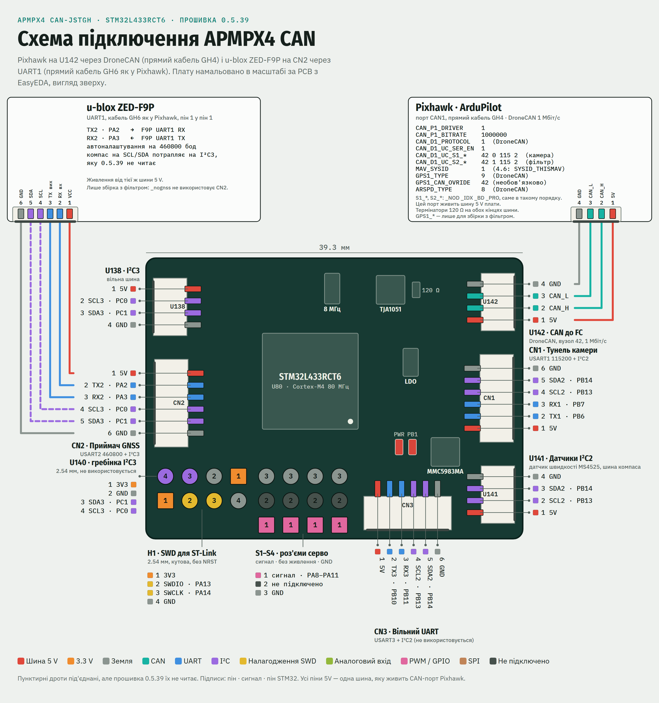

# APMPX4 CAN (STM32L433): інструкція

> Магазин плат: [GPS Spoofing Filter](https://airdroper.org/products/gps-spoofing-filter)

Плата APMPX4 CAN (проєкт EasyEDA "APMPX4 CAN-JSTGH", схема V1.0, 2026-03-17)
виконує ту саму прошивку фільтра, що описана в
[інструкції H743 DroneCAN](13_h743_dronecan.md), на меншому STM32L433RCT6 і
публікує дані у FC як DroneCAN node `42`. Інструкція описує прошивку `0.5.39`.

**Статус: ще не випущено.** Жодної прошивки L433 ще не опубліковано, тому
desktop app поки не може її встановити. Bench image `0.5.39` уже працював на
стендовій платі з ArduPlane 4.7.1: під чистим небом він передавав GPS у FC, а
на майданчику зі спуфінгом тримав GPS заблокованим, як і задумано (див.
`docs/dev/evidence/l433-bench-live-spoofing-2026-09-26.md`). Поки реліз не
оголошено в [журналі змін](CHANGELOG.md), вважайте цю плату пристроєм для
стенда й тестової команди.

## 1) Дві збірки прошивки

| Збірка | Що робить | Як встановлюється |
|--------|-----------|-------------------|
| `apmpx4_can_l433rc_dronecan` | GNSS-фільтр від спуфінгу: GNSS заходить на CN2, відфільтрований GPS виходить як DroneCAN; плюс airspeed, компас, тунель камери, оцінка палива й параметри. | Desktop app (release image) або напряму через SWD (bench image) |
| `apmpx4_can_l433rc_dronecan_nognss` | Усе, крім GNSS: airspeed, компас, тунель камери, оцінка палива й параметри на node `42`. CN2 не використовується, DR0/DR1 немає. | Лише напряму через SWD (bench image) |

Обидві збірки мають node ID `42`, тож не ставте по одній кожної на ту саму
шину CAN. DroneCAN-інструменти показують їх як
`org.airdroper.gnss_filter.l433_dronecan` і `org.airdroper.gnss_filter.l433_nognss`
з версією hardware `2.0` (у WeAct H743 — `1.0`). Поле VCS в інформації про
вузол містить повну версію прошивки: інструмент, що показує його в hex,
показує `00000539` для 0.5.39.

Якщо два вузли з ID `42` таки опиняться на одній шині, кожен із них кожні 10 с
повідомляє `CAN: another node uses ID 42 - ID clash` і показує себе unhealthy,
тож FC не дає армитися, доки один із них не прибрати.

## 2) Плата й роз'єми

- STM32L433RCT6 на 80 МГц від резонатора 8 МГц.
- CAN-трансивер TJA1051, 1 Мбіт/с. Термінатор 120 Ω (R56) запаяний завжди, тому
  плата має стояти на одному з кінців шини CAN: ніколи не посередині й ніколи
  не на тому самому кінці, що й інший вузол із термінатором.
- Роз'єми JST GH 1.25 мм у порядку пінів Pixhawk. Пін 1 кожного роз'єму — та
  сама шина 5 V.
- Немає USB і дисплея. Прошивання — через SWD на гребінці H1.
- Світлодіод статусу `LED1` на `PB1` (що він показує — у розділі 8).

| Роз'єм | Призначення | Піни |
|--------|-------------|------|
| U142 | CAN до FC | 1 `5V`, 2 `CAN_H`, 3 `CAN_L`, 4 `GND` |
| CN2 | Приймач GNSS (лише збірка з фільтром), USART2 | 1 `5V`, 2 `TX2` (`PA2`), 3 `RX2` (`PA3`), 4 `SCL3`, 5 `SDA3`, 6 `GND` |
| CN1 | MAVLink-тунель камери, USART1 на 115200 | 1 `5V`, 2 `TX1` (`PB6`), 3 `RX1` (`PB7`), 4 `SCL2`, 5 `SDA2`, 6 `GND` |
| U141 | Датчики I2C2: airspeed MS4525 | 1 `5V`, 2 `SCL2` (`PB13`), 3 `SDA2` (`PB14`), 4 `GND` |
| CN3 | Вільний UART (USART3) та I2C2; не використовується | 1 `5V`, 2 `TX3`, 3 `RX3`, 4 `SCL2`, 5 `SDA2`, 6 `GND` |
| H1 | SWD для ST-Link, 2.54 мм; без NRST | 1 `3V3`, 2 `SWDIO` (`PA13`), 3 `SWCLK` (`PA14`), 4 `GND` |

U138 і U140 виводять вільну шину I2C3, а S1–S4 — роз'єми серво (сигнал, не
підключено, GND) без живлення. Прошивка не використовує жодного з них; S1–S4,
лінії зумера й RGB-світлодіода вона тримає в низькому рівні. Компас на пінах 4–5
CN2 (I2C3) теж не читається. Компас MMC5983MA на платі сидить на I2C2 за
адресою `0x30`.

Повна розпіновка — обидва боки плати, усі контактні площадки й таблиці пінів —
це креслення A3:
[l433_apmpx4_can_pinout_uk.pdf](https://github.com/AirdroperUA/gnss-filter-user-docs/blob/main/diagrams/l433_apmpx4_can_pinout_uk.pdf)
(англійською:
[l433_apmpx4_can_pinout.pdf](https://github.com/AirdroperUA/gnss-filter-user-docs/blob/main/diagrams/l433_apmpx4_can_pinout.pdf)).

## 3) Підключення й живлення



1. **FC:** прямий CAN-кабель Pixhawk від U142 до порту CAN1 FC, пін 1 у пін 1.
   Цей кабель також живить плату: подавайте 5 V лише з одного джерела,
   зазвичай із CAN-порту FC.
2. **Приймач GNSS (збірка з фільтром):** прямий GPS-кабель Pixhawk від CN2 до
   UART приймача. `TX2` плати потрапляє на RX приймача, `RX2` — на його TX.
   Тип приймача задає параметр вузла `GNSS_TYPE`: `0` u-blox (за замовчуванням,
   автоматично налаштовується на 460800 бод), `1` UM980/UM981, `2` Septentrio
   Mosaic. Для UM980 чи Mosaic задайте `GNSS_TYPE` (як дістатися до параметрів
   вузла — у розділі 5), дочекайтеся повідомлення вузла `Tune saved` (кілька
   секунд, або приблизно до хвилини після попереднього збереження), а потім
   зніміть живлення плати на кілька секунд; лише після цього ввімкнення
   приймач знаходиться скануванням швидкостей. Кнопки скидання на платі немає,
   а DroneCAN restart у Mission Planner на цей вузол не діє. UM980 потребує ще й
   одноразового налаштування з інструкції
   [Конфігурація GNSS-приймача](09_receiver_config.md), а Mosaic — налаштування
   SBF з розділу
   [Septentrio Mosaic X5 SBF input](13_h743_dronecan.md#septentrio-mosaic-x5-sbf-input)
   інструкції H743.
3. **Камера:** CN1 до UART камери, TX і RX перехрещуються за функцією. Живіть
   камеру від власного джерела, якщо її споживання не вкладається в запас
   CAN-порту FC, і залиште піни 4–5 CN1 вільними: це шина датчиків.
4. **Airspeed:** модуль airspeed MS4525DO у стилі Pixhawk на U141, прямим
   кабелем. Пін 1 U141 — шина 5 V, а шина датчиків підтягнута на платі до 3.3 V
   і спільна з компасом на платі, тож потрібен модуль, який приймає 5 V, сам
   стабілізує собі 3.3 V і тримає лінії I2C на 3.3 V. Не під'єднуйте до U141
   голий датчик на 3.3 V. Датчик на модулі має бути тим, що вказаний в
   інструкції H743 (`4525DO-DS3AI001DP`: адреса `0x28`, `-1..+1 psi`,
   передавальна функція A).

**Лише логіка 3.3 V.** CN2 приймає лише логіку 3.3 V: пін прийому плати на
ньому (`RX2`, `PA3`) не витримує 5 V, а datasheet STM32L433 допускає на ньому
не більше 3.6 V. Під'єднуйте UART приймача з логікою 3.3 V (у приймачів
u-blox, UM980 і Mosaic, які описує ця інструкція, він є), і ніколи — рівні
5 V TTL чи RS-232. Роз'єми серво S1–S4 і пін прийому CN1 (`RX1`, `PB7`) теж
лише на 3.3 V — так їх налаштовує прошивка: внутрішні резистори
pull-up/pull-down, які вона вмикає, знімають із мікросхеми допуск 5 V.

**Компас на платі.** MMC5983MA розташований за кілька міліметрів від
світлодіода статусу й від доріжок 5 V, що живлять CN1 (камеру). Якщо
використовуєте компас на платі, по можливості живіть камеру окремо й перевірте
курс компаса з увімкненою та вимкненою камерою.

Живлення 3.3 V від ST-Link недостатньо для CAN. TJA1051 живиться від шини 5 V,
тож на самому ST-Link мікроконтролер працює, але CAN переходить у bus-off.

## 4) Прошивання

Прошивання через desktop app (активація, оновлення чи відновлення) стирає
збережені параметри плати. `GNSS_TYPE` повертається до `0` (u-blox), тож плата
з UM980 чи Mosaic після цього не знаходить приймач, доки `GNSS_TYPE` не задати
знову (розділ 3, крок 2). Після прошивання знову задайте його, `FUEL_CAPG` та
інші змінені параметри. Стендове завантаження через PlatformIO по SWD
(`pio run -e ... -t upload`) стирає лише ті сторінки flash, які займає image,
тож збережені параметри переживають його й переходять між збіркою з фільтром і
збіркою без GNSS.

**Через desktop app (release image).** У desktop app AirDroper виберіть
**L433 APMPX4 CAN (ST-Link)**. App завантажує image, прив'язаний до унікального
ID цієї плати, перевіряє його підпис, записує через ST-Link, читає назад і
блокує чип (RDP1). Кнопки скидання на платі немає: коли app попросить
перепідключити живлення плати, а також коли він закінчить, повністю зніміть
живлення щонайменше на 10 секунд і подайте знову. Для цього потрібен
опублікований реліз L433, тому поки це не працює (див. «Статус» вище).

Після прошивання L433 app також виводить «Ключ підпису автентифікованого
відновлення DR» цієї плати (в англійському інтерфейсі —
`Authenticated DR-recovery signing key`) і просить зберегти його одразу: ключ
один на плату, і пізніше його не відновити. Тримайте його в секреті, як
пароль: будь-хто, хто його має, може авторизувати вихід цієї плати з DR1.

Release image не стартує на платі, до якої не прив'язаний, і на незаблокованій
платі. Тоді світлодіод швидко блимає: 100 мс увімкнено, 100 мс вимкнено.
Повторіть оновлення в desktop app.

**Напряму через SWD (bench images).** Під'єднайте H1 до ST-Link: `SWDIO`,
`SWCLK` і `GND`. На оригінальних ST-LINK/V2, V3 чи Nucleo пін 1 (`3V3`) —
це вхід вимірювання напруги цілі: його треба під'єднати завжди, а плату живити
від іншого джерела. На клонах ST-Link цей пін видає 3.3 V, тож під'єднуйте його
лише коли плату більше ніщо не живить. На H1 немає NRST, тому підключайтеся в
режимі Normal або Hot-plug, ніколи не under reset. Далі збірка й завантаження:

```text
pio run -e apmpx4_can_l433rc_dronecan -t upload
pio run -e apmpx4_can_l433rc_dronecan_nognss -t upload
```

Плату, яку заблокував desktop app (RDP1), так прошити не вийде. Спершу
розблокуйте її. Для L433 це робить **Відновити плату** (Recover Board) у
desktop app: знімає блокування, що стирає весь чип, і перевіряє, що flash
порожня. З командного рядка скористайтеся STM32CubeProgrammer і змініть лише
option byte RDP, а потім повністю зніміть живлення щонайменше на 10 секунд:

```text
STM32_Programmer_CLI -c port=SWD mode=NORMAL -ob RDP=0xAA
```

Розблокування стирає весь чип: прошивку та її параметри. Зняття живлення після
нього очищає запис палива й стан DR1, який плата зберегла через скидання
(розділ 8). Ніколи не записуйте `RDP=0xCC`: це level 2, який вимикає SWD
назавжди.

Ніколи не прошивайте `apmpx4_can_l433rc_dronecan_release` напряму: він працює
лише після того, як server прив'язав його до плати, а desktop app заблокував
чип.

Після першого прошивання чистого чипа вимкніть і ввімкніть живлення плати.
Чистий STM32L4 запускає свій ROM bootloader, доки не буде power-on reset.

## 5) Налаштування FC (ArduPilot)

Потрібен ArduPilot 4.6.1 або новіший: збірка з фільтром не видає GPS старішому
автопілоту.

Налаштування CAN і тунелів такі самі, як на H743. Розділ «ArduPilot setup»
інструкції H743 діє без змін, зокрема його жорсткі умови для виходу GPS: тунель
фільтра з живим `EKF_STATUS_REPORT` і MAVLink system ID FC, рівний 1:
`MAV_SYSID = 1` на ArduPilot 4.7 і новіших, `SYSID_THISMAV = 1` на 4.6. Фільтр
приймає telemetry FC лише від system 1, component 1.

| Призначення | Параметр | Значення |
|-------------|----------|----------|
| Драйвер CAN на CAN1 | `CAN_P1_DRIVER` | `1` |
| Протокол DroneCAN | `CAN_D1_PROTOCOL` | `1` |
| Швидкість CAN | `CAN_P1_BITRATE` | `1000000` |
| Тип GPS (збірка з фільтром) | `GPS1_TYPE` | `9` (DroneCAN) |
| Автоналаштування GPS (збірка з фільтром) | `GPS_AUTO_CONFIG` | `1` |
| Необов'язкова прив'язка GPS до вузла (лише збірка з фільтром, див. розділ 7) | `GPS1_CAN_OVRIDE` | `42` |
| Увімкнути DroneCAN serial | `CAN_D1_UC_SER_EN` | `1` |
| Порт камери: вузол / індекс / швидкість / протокол | `CAN_D1_UC_S1_NOD` / `_IDX` / `_BD` / `_PRO` | `42` / `0` / `115` / `2` |
| Порт фільтра: вузол / індекс / швидкість / протокол | `CAN_D1_UC_S2_NOD` / `_IDX` / `_BD` / `_PRO` | `42` / `1` / `115` / `2` |
| MAVLink system ID FC (4.6: `SYSID_THISMAV`) | `MAV_SYSID` | `1` |
| Airspeed | `ARSPD_TYPE` | `8` (DroneCAN) |

- **Airspeed:** відкалібруйте трубку Піто у встановленому планері, потім
  задайте `ARSPD_USE = 1` і біт 0 в `AHRS_OPTIONS`. Зі збіркою з фільтром це
  вимога безпеки польоту: щойно DR1 спрацює, літак має летіти без GPS (див.
  інструкцію H743).
- **Компас:** у Mission Planner відкрийте `Setup -> Mandatory Hardware -> Compass`,
  переконайтеся, що з'явився компас від node `42`, задайте орієнтацію й
  пріоритет і відкалібруйте його у встановленому апараті. MMC5983MA на платі —
  це компас `0` вузла `42`, а зовнішній компас на шині датчиків — компас `1`,
  тож кожен має власні орієнтацію й калібрування: після того як ви додали,
  зняли чи замінили зовнішній компас, FC бачить інший компас, який треба
  налаштувати, а не старий із чужим калібруванням.
- **Порти тунелів:** `_PRO` має бути `2` (MAVLink2) на обох портах; з `1` вузол
  відкидає трафік цього порту. Перезавантажте FC після зміни будь-якого
  параметра CAN чи serial-налаштувань `CAN_D1_UC_*`: ArduPilot налаштовує
  драйвер CAN і порти тунелів лише під час старту.
- **Власні параметри вузла** (`GNSS_TYPE`, `FUEL_CAPG` та інші) доступні через
  FC, бо USB на платі немає: у Mission Planner відкрийте
  `SETUP -> Optional Hardware -> DroneCAN/UAVCAN`, підключіться й відкрийте
  **Menu -> Parameters** на node `42`. Повна процедура — у розділі «Варіант A:
  DroneCAN через flight controller» інструкції H743. Де там сказано
  перезавантажити плату, тут це означає перепідключити живлення: дочекайтеся,
  поки вузол збереже значення (він повідомляє `Tune saved`), потім зніміть
  живлення плати на кілька секунд і після цього перевірте, що значення
  збереглося. Кнопки скидання на платі немає, а вузол не реалізує DroneCAN
  RestartNode, тож DroneCAN restart у Mission Planner нічого не робить.
- **Заміна плати:** FC запам'ятовує, яка плата має node `42`. Після заміни на
  іншу плату (L433 замість H743 або одну L433 на іншу) він показує
  `Duplicate Node` і не дає армитися. Увімкніть біт 0 у `CAN_D1_UC_OPTION`, не
  змінюючи інших бітів (якщо значення парне, додайте до нього 1), і один раз
  перезавантажте FC: під час старту ArduPilot очищає базу вузлів, а потім
  і цей біт. Також знову відкалібруйте компас: для FC компас нової плати — це
  той самий компас, і він лишив би йому калібрування старої плати.

## 6) Необов'язкові датчики

Датчик airspeed MS4525 і компас вбудовані в обидві збірки й обидва
необов'язкові:

- Датчик, який не відповів після ввімкнення живлення, вважається
  невстановленим. Він не викликає помилки й попередження
  `I2C AIR=... MAG=...`, тож вузол лишається healthy.
- Датчик, який відповідав, а потім перестав, викликає помилку: ArduPilot
  показує `Node 42 unhealthy!` і не дає армитися, як на H743.
- Датчик, який уперше відповів пізніше за ввімкнення, відтоді вважається
  встановленим. Проте ArduPilot шукає датчики airspeed лише під час свого
  старту, тож після під'єднання датчика перезавантажте FC.
- Перший компас, знайдений після ввімкнення, — єдиний, що використовується до
  вимкнення живлення. Якщо він перестає відповідати, вузол повідомляє про
  помилку й ніколи не перемикається на інший компас, наприклад на MMC5983MA на
  платі, у якого інше калібрування й орієнтація.

Вузол публікує airspeed як `RawAirData`, а компас як `MagneticFieldStrength2`,
без обробки. Усе калібрування — справа ArduPilot.

**Польоти збірки з фільтром без трубки Піто** погіршують вихід із DR1:
перевірка ground speed проти airspeed ніколи не проходить, тож щоб вийти з DR1
в польоті, потрібен справжній набір висоти або тривалий розворот; горизонтальний
прямолінійний політ не допоможе.

## 7) Збірка без GNSS

`apmpx4_can_l433rc_dronecan_nognss` — для апаратів, які беруть GPS з іншого
джерела й хочуть від плати лише airspeed, компас і тунель камери:

- Вона ніколи не публікує GPS, ніколи не входить у DR1 і нічого не блокує, а її
  NodeStatus ніколи не показує GNSS заблокованим.
- Параметри GNSS і DR1 лишаються в списку параметрів вузла, але в цій збірці
  нічого не роблять, і збереження такого параметра це й повідомляє, наприклад
  `GNSS_TYPE=1 saved (no GNSS in this build)`. На запит скидання в `UBX_RESET`
  вона відповідає `UBX_RESET ignored: no GNSS in this build`; його значення
  спокою `0`, яке записує файл параметрів, приймається без повідомлення.
  Read-only параметрів `GPS1_TYPE` і `GPS_TYPE`, які показує DroneCAN GPS-вузол,
  у її списку немає.
- На команду оператора «block GNSS» вона відповідає `UNSUPPORTED`, а на
  зняття DR1 — що вузол не в DR1. Без DR1 немає й автентифікованого
  відновлення DR та ключа підпису.
- Її статусні повідомлення приходять один раз, від system 42. Збірка з
  фільтром ще й повторює кожне як GPS-компонент FC (system 1, component 220);
  ця збірка — не GPS, тож цього не робить.
- `GPS1_TYPE` залиште для того GPS, який апарат справді використовує. Коли
  апарат переходить зі збірки з фільтром на цю, поверніть `GPS1_CAN_OVRIDE` у
  `0` (або задайте node ID справжнього DroneCAN GPS): node `42` тут ніколи не
  надсилає GPS, тож прив'язка до `42` блокує справжній GPS.
- Налаштування CAN, тунелів, airspeed і компаса залиште з розділу 5, зокрема
  тунель фільтра (S2) і system ID FC, рівний 1. Статусні повідомлення вузла
  доходять до Mission Planner лише через цей тунель, зміни параметрів вузол
  приймає лише від FC, який знайшов через тунелі, а telemetry FC, яку він там
  читає (наприклад, throttle і RPM для оцінки палива), зараховується лише від
  system 1.

## 8) Пошук несправностей

Дисплея на платі немає. Її статусні повідомлення доходять до Mission Planner
через тунель фільтра (DroneCAN serial порт 2 на FC, індекс `1`), тож без цього
тунелю повідомлень немає зовсім. Рядки перших секунд після ввімкнення, до
підключення тунелю, зберігаються й надсилаються, щойно він підключиться:
стартовий банер, версія прошивки й ID плати, а також (з окремим запасом місця)
попередження, як-от рядки про скидання й DR1 нижче. Стан показує світлодіод:

| LED1 | Що означає |
|------|------------|
| Спалах 80 мс кожні 6 с | Працює, DR0 (вихід GNSS дозволений, якщо проходять усі інші перевірки); збірка без GNSS показує завжди це |
| Спалах 50 мс кожні 250 мс | DR1: GNSS заблоковано |
| 100 мс увімкнено, 100 мс вимкнено одразу після ввімкнення | Прошивка відмовилася стартувати: release image прив'язаний до іншої плати або плата не заблокована. Повторіть оновлення в desktop app |

- **Node 42 не з'являється:** перевірте, що на U142 є 5 V, кабель прямий (пін 1
  у пін 1), швидкість `1000000`, а плата стоїть на кінці шини.
- **CAN у bus-off на стенді:** найімовірніше, плата живиться лише від ST-Link.
  Подайте живлення на шину 5 V.
- **`Node 42 unhealthy!`:** вузол повідомляє, що він unhealthy, з чотирьох
  причин:
  - датчик, який був знайдений, перестав відповідати або його дані не доходять
    до CAN; статусне повідомлення `I2C AIR=... MAG=...` називає, який саме;
  - DR1 (збірка з фільтром) через спуфінг чи несправність: див. «GPS
    заблоковано (DR1)» нижче;
  - тактування: `CLOCK: resonator failed, on HSI16 - CAN marginal` означає, що
    резонатор 8 МГц не запустився, а `CLOCK: resonator stopped, on HSI16 - CAN
    marginal` — що він зупинився під час роботи й це скинуло плату. В обох
    випадках плата до наступного вимкнення живлення працює від внутрішнього
    генератора, якого може бракувати для точності CAN: після трьох bus-off на
    ньому вузол до вимкнення живлення лишається поза шиною, тож FC втрачає node
    `42`, а не всю шину. Плата потребує ремонту;
  - на шині є ще один вузол з ID `42`: `CAN: another node uses ID 42 - ID
    clash`, кожні 10 с, доки це триває. Приберіть один із них (розділ 1).
- **GPS заблоковано (DR1, збірка з фільтром):** перший рядок
  `GNSS BLOCKED #n: <причина>` епізоду називає, чому спрацював DR1; те саме
  показує `DR_REASON` — значення, яке вузол надсилає кожні 5 с. Далі цей рядок
  повторюється кожні 5 с, але відтоді називає те, що заважає відновленню
  зараз, а не причину спрацювання: наприклад, `no-anchor` означає, що від
  увімкнення живлення не було жодного довіреного fix. Причин DR1 кілька; дві з
  них тут варто знати:
  - `FC LINK STALE`, часто на новій установці: неправильно налаштований тунель
    фільтра або system ID FC (`MAV_SYSID`, на 4.6 — `SYSID_THISMAV`); див.
    розділ «FC LINK STALE: одна причина, чотири повідомлення» інструкції H743;
  - `SOUTH HEMISPHERE` (`DR_REASON` 8) — це активний спуфінг: приймач видав
    дійсний fix південніше екватора й західніше Гринвіча. На землі вузол
    ніколи не знімає цю причину сам. Коли спуфінг припиниться, зніміть
    живлення плати щонайменше на 10 секунд. Скидання без зняття живлення чи
    коротша перерва повертає DR1 з тією самою причиною (див. «DR1 kept across
    reset» нижче), а перезавантаження FC допоможе, лише якщо воно знімає 5 V
    із CAN-порту на стільки ж. Доти FC показує `PreArm: GPS 1: Bad fix` і
    `PreArm: DroneCAN: Node 42 unhealthy!`. З приймачем u-blox очікувано
    бачити `GNSS hot ...` і `GNSS cold ...` через 10 хвилин без fix, а далі
    `GNSS cold retry` кожні 2 хвилини.
- **`DR1 kept across reset: <причина>` (збірка з фільтром):** плата
  скинулася без втрати живлення (watchdog, збій, просідання живлення), коли
  DR1 був активний, і знову стартувала в ньому з тією самою причиною та
  довіреною позицією, яку мала. Вихід GNSS лишається заблокованим, доки його не
  відпустять звичайні докази відновлення, а для `SOUTH HEMISPHERE` і
  `OPERATOR BLOCK` — доки живлення плати не зняти щонайменше на 10 секунд.
  Після скидання поза DR1 вузол зберігає лише довірену позицію
  (`North anchor kept across reset`), і вихід GNSS відкривається лише після
  стартового guard (20 с, або 2 с, поки FC повідомляє, що він armed).
- **`RESET: ...` після ввімкнення:** плата скинулася без вимкнення живлення й
  повідомляє чому. `RESET: watchdog` означає, що прошивка перестала
  відповідати; `RESET: HardFault PC=... CFSR=...` (або `MemManage`,
  `BusFault`, `UsageFault`, `NMI ...`) — що вона впала, а два значення
  показують де. Повідомте будь-який такий рядок повністю. `RESET: software`
  буває після завантаження через debugger, а `RESET: option-byte load` — після
  блокування, яке ставить desktop app. Звичайне ввімкнення нічого не пише.
- **`BACKUP: store failed, nothing kept across reset`:** регістри, що
  зберігають підсумок палива й стан DR1 через скидання, не пройшли стартову
  перевірку. Плата не зберігає ні того, ні іншого, тож підсумок палива після
  кожного скидання втрачено. Плата потребує ремонту.
- **`CAN rxerr=... boff=... purge=...`:** лічильники CAN вузла від увімкнення:
  втрачені прийняті кадри, події bus-off і скинуті черги передавання, серед
  яких і навмисне скидання при кожному вході в DR1. Рядок приходить, коли
  змінюється лічильник, а поки CAN-контролер вузла в error-passive, до нього
  додається ` EPASS`. `rxerr` чи `boff`, що постійно зростає, або `EPASS`
  вказують на проводку, термінатор (розділ 2) чи живлення 5 V.
- **`Fuel total unknown: no engine RPM from FC`:** на цій платі підсумок палива
  після кожного ввімкнення невідомий (ніщо не зберігає його через вимкнення
  живлення), а FC ще не надіслав RPM двигуна, тож оцінювати нічого. Рядок
  приходить один раз і нормальний для апарата без джерела RPM двигуна. Щойно
  RPM надходить, `Fuel total LOST - write FUEL_CAPG to restart it` повторюється
  щохвилини, доки не записати `FUEL_CAPG`; див. розділ про оцінку палива
  двигуна в інструкції H743.
- **`Duplicate Node` після заміни плати:** див. «Заміна плати» в розділі 5.
- **Немає GPS на FC (збірка з фільтром):** спершу подивіться на світлодіод.
  Якщо він показує DR1, див. «GPS заблоковано (DR1)» вище. Якщо DR0 — пройдіть
  розділ «Якщо щось не працює» в інструкції H743, пропускаючи перевірки
  дисплея; причини ті самі.
